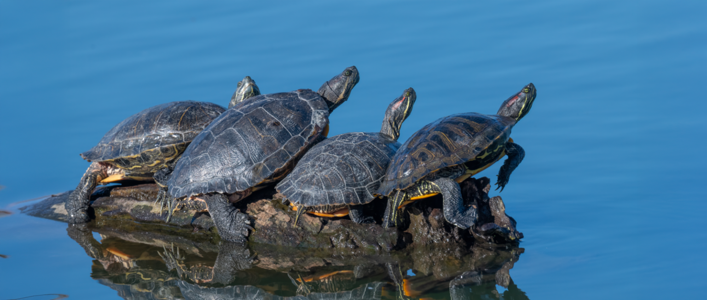
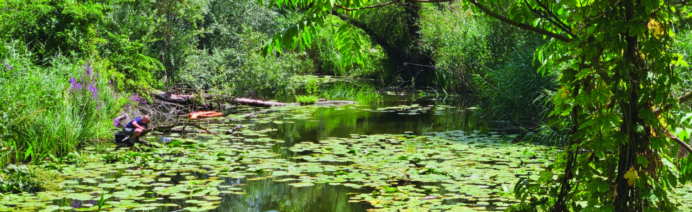

Invasive alien species are a major cause of biodiversity loss, impacting human health and economic activities, and more in general native biodiversity via predation, competition for resources, habitat alteration and hybridization. There are numerous ways to control invasive species, but management success can vary widely depending on the target species and socioeconomic context. A formal evaluation helps choose the best management methods given limited resources and complex ethical implications of lethal and non-lethal control methods.

Our group, including active contributions by MSc and BSc students, focusses on control methods for the pond slider turtle *Trachemys scripta*, one of the 100 worst invasive species according to the IUCN. The presence of *T. scripta* negatively impacts native freshwater systems, particularly through competition with the native turtle in Switzerland, *Emys orbicularis*. While the trade of *T. scripta* has been banned in most countries, their presence and proliferation require active removal and control to minimize damage on local ecosystems.

In this project, we collaborate with managers in multiple European countries to assess commonly used control methods for *T. scripta*, by testing them in terms of their biological effectiveness, costs and animal welfare implications. To achieve this, we conduct field experiments with detection dogs, use insights from population modelling and adopt tools from veterinary science. The final goal is to facilitate rational planning, balancing ethical and financial constraints against biological evidence, allowing optimal protection of native species.

*Shaquille Matthys*

## Uni Bern supervisors

PD Dr. Stefano Canessa & Shaquille Matthys

## External collaborators

[Life URCA PROEMYS](https://www.urcaproemys.eu/en/home-en/)

[Dr. Njal Rollinson](https://rollinson.eeb.utoronto.ca/)

## PhD thesis

Matthys, S. (2023-ongoing). Dealing with uncertainty and conflicting objectives in the control of invasive species. PhD Thesis, University of Bern.

## MSc theses

Moser, L.A. 2025. Evaluating animal welfare for rational decision making in the management of the invasive pond slider *Trachemys scripta.* Master thesis. University of Bern.

Matthys, S. 2023. Assessing control methods for the invasive Pond Slider *Trachemys scripta* in Switzerland. Master Thesis. University of Bern.
