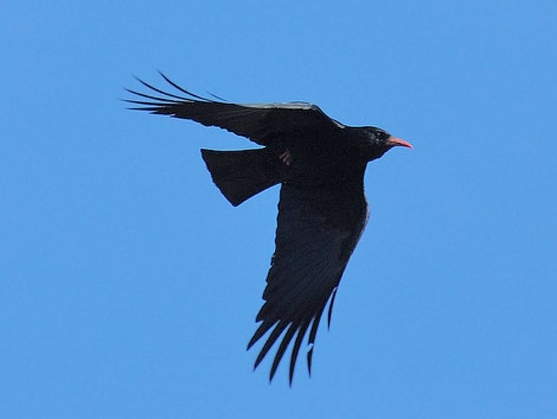

The Red-billed chough reaches in the Alps of Valais its northermost outpost in Central Europe. We are currently modelling habitat suitability to provide some guidance for habitat management.

## Uni Bern supervisor

Raphaël Arlettaz

## Publications

Braunisch, V., S. Vignali, P.A. Oggier & R. Arlettaz. 2021. Present in the western European Alps but absent in the eastern part: Can habitat availability explain the differences in red-billed chough occurrence? Journal of Avian Biology 52: e02682. [(PDF, 1.8 MB)](/files/flying_vertebrates_vs_wind_turbines/Braunisch_JAviBio2021_eng.pdf)
