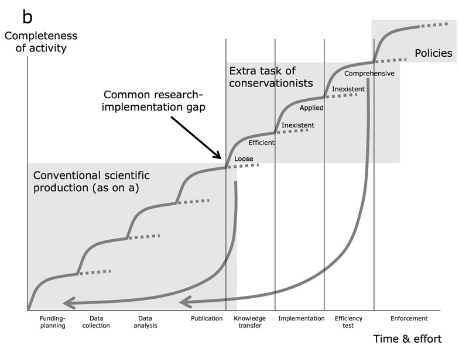

## Bridging the research-action gap

One of the major issues in conservation biology and conservation biology is to bridge the gap between research and implementation so that we not only produce essential knowledge to inform management, but also push towards concretizing evidence-based actions that can effectively improve the situation for biodiversity in the real world. We are currently reflecting on new standards and accredition systems for evaluating scientific production and scientists’ career profiles, which can offer more latitude to conservation researchers to become more active in practice, with in turn recognition of such activities by the scientific community.

## Publications

Arlettaz, R., M. Schaub, J. Fournier, T.S. Reichlin, A. Sierro, J.E.M. Watson & V. Braunisch. 2010. From Publications to Public Actions: When Conservation Biologists Bridge the Gap between Research and Implementation. BioScience 60: 835-842. [(PDF, 8.4 MB)](/files/research_implementation/Arlettaz_BioSci2010_eng.pdf)
