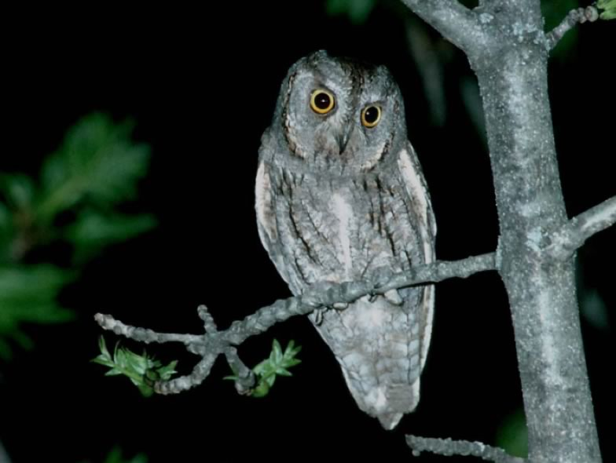

This insectivorous nocturnal raptor is migratory in Central Europe. In Switzerland it breeds only in the South (Valais and Ticino). The species suffers from the decrease of invertebrate-rich meadows following agricultural intensification. The Swiss Ornithological Institute tries to enhance habitat suitability by promoting uncut field margins in grasslands to improve conditions for grasshoppers, the main prey of this owlet.

## Uni Bern supervisor

Raphaël Arlettaz

## Publications

Sierro, A. & R. Arlettaz. 2013. Utilisation de l'habitat et stratégie de chasse chez les derniers Petit-ducs *Otus scops* de l'adret valaisan: mesures de conservation ciblées. Nos Oiseaux 60:79-90. [(PDF, 578KB)](/files/scops_owl/Sierro_NosOis2013_eng.pdf)

Sierro, A. & R. Arlettaz. 2009. Bande erbose non sfalciate per favorire l'Assiolo *Otus scops*. Ficedula 42: 2-8. [(PDF, 2.6 MB)](/files/scops_owl/Sierro_Fice2009_eng.pdf)

## Related Master thesis

Klein, N. 2019. Effects of grassland management intensity on orthopterans as food resource for insectivorous birds. Master Thesis, University of Bern. [PDF](/files/lowland_grassland/Klein_MSc2019_eng.pdf)
