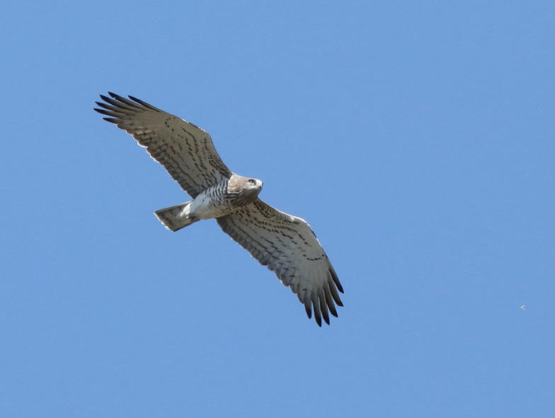

Several species of raptors, among both the diurnal and nocturnal birds of prey, play the role of environmental sentinels, meaning that their populations often decline following some degradation in the general environment. Vice versa, their population recovery may indicate an amelioration of environmental conditions.

Our group contributes to monitor and carry out research on several species of raptors in the Swiss Alps since years, in particular eagle owls, peregrine falcons and short-toed snake eagles.

Long persecuted by man, the short-toed snake eagle (*Circaetus gallicus*) is currently (re)colonizing the southern regions of Switzerland, in particular Ticino and the Upper Rhone valley (Valais and Vaud Chablais). We are tightly monitoring the latter population since 2017, after a first successful reproduction in 2012. Valais and Vaud Chablais harboured 7 territories in 2022, among which 4 pairs successfully raised one chick each to fledging, a rule in that single breeder. This species is specialized on snakes and thus migrate to Africa in winter (September-March). Its recent spatial expansion towards higher latitudes in Central Europe probably results from a better protection than in the past and global warming. In effect, this species has a very long reproductive cycle: earlier springs and later falls may enhance its ability to fully accomplish its breeding cycle at higher latitudes than before.

## Publications

Arlettaz, R., L. Maumary, J. Cloutier, A. Rnjakovic, K. Agten, V. Debons & M. Wagen-Jaussy. 2024. Colonisation de la haute vallée suisse du Rhône par le Circaète Jean-le-Blanc *Circaetus gallicus*: dynamique et considérations écologiques. Nos Oiseaux 71: 91-104. [PDF](/files/short_toed_snake_eagle/Arlettaz_NosOis2024_eng.pdf)

Arlettaz, R., S. Mettaz & K. Agten. 2018. Première nidification réussie du Circaète Jean-le-Blanc *Circaetus gallicus* en Suisse romande. Nos Oiseaux 65 (3): 175-179. [PDF](/files/short_toed_snake_eagle/Arlettaz_NosOis2018_eng.pdf)
