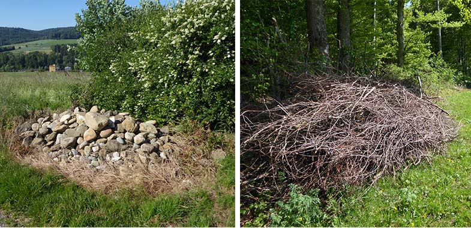

Farmland biodiversity is still declining in Switzerland and around Europe despite all efforts and increasing money invested in agri-environmental measures. In this context, small structures, such as piles of branches or stones, are more and more popular and recommended as greening measures. It is quite intuitive that a multitude of organisms benefit from these structures, however, there is very little scientific evidence behind (reviewed in Rossier et al. 2021). It appears that in order to better promote the species that depend on these small structures, further scientific studies are needed.

The goal of this research project is to determine quantitatively which species are favoured by the presence of piles of branches or stones and to better understand the role of these small structures on the functionality of agroecosystems (e.g. as a stepping stone for animal dispersal). The project has two complementary real-scale modules: an observational module and an experimental module. The observational module focus on stoats (*Mustela erminea*) and common weasels (*Mustela nivalis*), while the experimental module (which is planned to start in 2023) will be much more comprehensive (including reptiles, amphibians and invertebrates). Ultimately, the project will deliver evidence-based recommendations on when, where and how to place these structures in the landscape to conserve and restore farmland biodiversity.

#### «Gesucht: [Hermelin und Mauswiesel (Deutsch)](/research/hermelinmauswiesel/)»

## Uni Bern supervisor

Jean-Yves Humbert

## Publications

Otte, P.J., S.P. Carter, A.C. Dürst, M. Granata, J. Mos, S. Salvador, V. Valdez, K. Zub & T.R. Hofmeester. 2026. Too small to matter? a call to action for european small mustelid research. Mammal Research 71: article number 39. [PDF](/files/publications/Otte_MamRes2026_eng.pdf)

Dürst, A.C., G.B. Egloff, L. Schenker, R. Arlettaz & J.Y. Humbert. 2026. Regional biodiversity conservation projects enhance stoat populations in agricultural landscapes. Global Ecology and Conservation 66: Article Number e0408. [PDF](/files/publications/Durst_GloEcoCon2026_eng.pdf)

Egloff, G.B., L. Schenker, S. Riverendo, A.C. Dürst, G. Heckel, D. Karp & J.Y. Humbert. 2025. The role of small structures for stoats in agricultural landscapes. Journal for Nature Conservation 85: Article Number 126865. [PDF](/files/small_structures/Egloff_JNatCon2025_eng.pdf)

Jachowski, D.S., S.M. Bergeson, S.R. Cotey, E. Croose, T.R. Hofmeester, J. MacPherson, P. Wright, C.A. Calderón-Acevedo, S.P. Carter, A.C. Dürst, G.B. Egloff, M.K. Hamed, P. Hapeman, S.N. Harris, K. Hassler, J.Y. Humbert, D. Karp, R. Kays, J. Mausbach, D.J. Morin, J. Mos, S.S. Allué, L. Smith, J.P. Twining, C.R. Williamson & K. Zub. 2024. Non-invasive methods for monitoring weasels: emerging technologies and priorities for future research. Mammal Review 54: 243-260. [PDF](/files/small_structures/Jachowski_MamR2024_eng.pdf)

Rossier L., O. Roth & J.Y. Humbert. 2021. Ast- und Steinhaufen – und wer davon profitieren könnte - Eine Literaturstudie zu ihrer Bedeutung für Wiesel, Amphibien und Reptilien. Abteilung Conservation Biology der Universität Bern. [PDF](/files/small_structures/Rossier_Rep2021_eng.pdf)

## Related PhD thesis

Dürst, A.C. (2022 – ongoing). Small structures to promote biodiversity in agricultural landscapes. PhD Thesis, University of Bern.

## Related Master theses

Vomsattel, H. 2026. The influence of isolated stone and branch piles on stoats (*Mustela erminea*) and weasels (*Mustela nivalis*) in agricultural landscapes. Master Thesis. University of Bern.

Schärer, L. 2025. The effects of small structures on the carabid beetle community in agricultural landscapes. Master Thesis. University of Bern.

Stettler, J. 2025. Influence of stone piles and surroundings on stoat occurrence in intensively managed fruit-tree cultures. Master Thesis. University of Bern.

Egloff, G.B. 2024. The role of small structures for stoats in agricultural landscapes. Master Thesis. University of Bern. [PDF](/files/small_structures/Egloff_MSc2024_eng.pdf)

Schenker, L. 2023. Assessing the ecological value of small structures for mustelid populations in agricultural landscapes. Master Thesis. University of Bern. [PDF](/files/small_structures/Schenker_MSc2023_eng.pdf)
