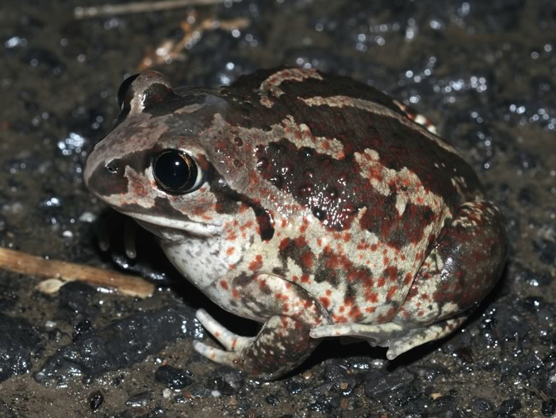

Analyses of population dynamics of amphibians are complicated, because it is difficult to follow individuals from birth to death. Usually amphibians can only be marked and individually followed when they have reached adult size. Because spadefoot toad (*Pelobates fuscus*) froglings are hugh when they leave the pond after metamorphosis, they can be marked at that time. In this project we analyse capture-recapture data of spadefoot toads collected during a 10 year project in Vienna (Prof. W. Hödl). We estimate juvenile and adult survival, the age at first reproduction and test whether these life history traits depend on individual characteristica (size, body mass), on the timing of metamorphosis or on environmental variables. This analysis will enhance our understanding of amphibian population dynamics.

## Uni Bern supervisor

Michael Schaub

## External collaborators

Dr. Benedikt R. Schmidt, KARCH, Neuchâtel, Switzerland

Prof. Walter Hödl, Institut für Zoologie, Universität Wien, Austria

## Publications

Schmidt, B.R., W. Hödl & M. Schaub. 2012. From metamorphosis to maturity in complex life cycles: equal performance of different juvenile life history pathways. Ecology 93: 657-667. [(PDF, 1.8 MB)](/files/spadefoot_toad/Schmidt_Eco2012_eng.pdf)
