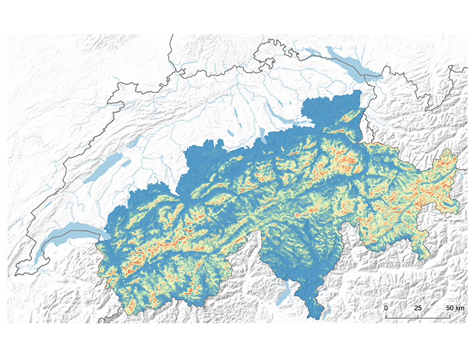

Predicting species’ distributions and spatial patterns of habitat use or dispersal is central to many questions in ecology and conservation science - and indispensable for applied conservation planning. We develop and evaluate spatially explicit methods for analysing these aspects, based on different types of species data (e.g. direct observations, telemetry data or genetic information). Thereby we focus on solutions addressing the particular problems linked with conservation: The work with elusive, rare and endangered species often involves incomplete data, e.g. due to imperfect detection or unreliable absences. In addition, money and time constraints in conservation practice call for methods that allow sound predictions from cost-efficient sampling schemes or existing databases. Our aim is to provide conservation scientists and practitioners with applicable information and tools that enable them to sample and process their data in the best possible way in order to produce reliable information for conservation planning.

## Uni Bern supervisors

Sergio Vignali, Veronika Braunisch, Alexandre Hirzel

## Publications

Kass, J.M., A.B. Smith, D.L. Warren, S. Vignali, S. Schmitt, M.E. Aiello-Lammens, E. Arlé, A.M. Barbosa, O. Broennimann, M.E. Cobos, M. Guéguen, A. Guisan, C. Merow, B. Naimi,  M.P. Nobis, I. Ondo, L. Osorio-Olvera, H.L. Owens, G.E. Pinilla-Buitrago, A. Sánchez-Tapia, W. Thuiller, R. Valavi, S.J.E. Velazco, A. Zizka & D. Zurell. 2025. Achieving higher standards in species distribution modeling by leveraging the diversity of available software. Ecography 2025: e07346. [PDF](/files/spatial_modeling/Kass_Ecogra2025_eng.pdf)

Vignali, S., A.G. Barras, R. Arlettaz & V. Braunisch. 2020. *SDMtune*: An R package to tune and evaluate species distribution models. Ecology and Evolution 10: 11488-11506. [(PDF, 738KB)](/files/spatial_modeling/Vignali_EcoEvo2020_eng.pdf)

Zielewska-Büttner, K., M. Heurich, J. Müller & V. Braunisch. 2018. Remotely Sensed Single Tree Data Enable the Determination of Habitat Thresholds for the Three-Toed Woodpecker (*Picoides tridactylus*). Remote Sensing 10: art. 1972. [(PDF, 956KB)](/files/spatial_modeling/Zielewska-Buttner_RemSen2018_eng.pdf)

Braunisch, V., P. Patthey & R. Arlettaz. 2016. Where to Combat Shrub Encroachment in Alpine Timberline Ecosystems: Combining Remotely-Sensed Vegetation Information with Species Habitat Modelling. PLoS ONE 11: e0164318. [(PDF, 2.1 MB)](/files/black_grouse/Braunisch_PLoSONE2016_eng.pdf)

Braunisch, V., P. Patthey & R. Arlettaz. 2011. Spatially explicit modeling of conflict zones between wildlife and snow sports: prioritizing areas for winter refuges. Ecological Applications 21: 955-967. [(PDF, 2.1 MB)](/files/black_grouse/Braunisch_EcoApp2011_eng.pdf)

Braunisch, V., G. Segelbacher & A.H. Hirzel. 2010. Modelling functional landscape connectivity from genetic population structure: a new spatially explicit approach. Molecular Ecology 19: 3664-3678. [(PDF, 636KB)](/files/spatial_modeling/Braunisch_MolEco2010_eng.pdf)

Braunisch, V. & R. Suchant. 2010. Predicting species distributions based on incomplete survey data: the trade-off between precision and scale. Ecography 33: 826-840. [(PDF, 532KB)](/files/spatial_modeling/Braunisch_Ecogra2010_eng.pdf)

Braunisch, V., K. Bollmann, R.F. Graf & A.H. Hirzel. 2008. Living on the edge – Modelling habitat suitability for species at the edge of their fundamental niche. Ecological Modelling 214: 153-167. [(PDF, 1.0 MB)](/files/spatial_modeling/Braunisch_EcoMod2008_eng.pdf)

Hirzel, A.H. & G. Le Lay. 2008. Habitat suitability modelling and niche theory. Journal of Applied Ecology 45: 1372-1381. [(PDF, 500KB)](/files/spatial_modeling/Hirzel_JAppEco2008_eng.pdf)

Sattler, T., F. Bontadina, A.H. Hirzel & R. Arlettaz. 2007. Ecological niche modelling of two cryptic bat species calls for a reassessment of their conservation status. Journal of Applied Ecology 44: 1188-1199. [(PDF, 754KB)](/files/pipistrelle_bats/Sattler_JAppEco2007_eng.pdf)

Hirzel, A.H., G. Le Lay, V. Helfer, C. Randin & A. Guisan. 2006. Evaluating the ability of habitat suitability models to predict species presences. Ecological Modelling 199: 142-152. [(PDF, 958KB)](/files/spatial_modeling/Hirzel_EcoMod2006_eng.pdf)

Hirzel, A.H. & R. Arlettaz. 2003. Modelling habitat suitability for complex species distributions by the environmental-distance geometric mean. Environmental Management 32: 614-623. [(PDF, 1.0 MB)](/files/bearded_vulture/Hirzel_EnvMan2003_eng.pdf)

Hirzel, A. & A. Guisan. 2002. Which is the optimal sampling strategy for habitat suitability modelling. Ecological Modelling 157: 331-341. [(PDF, 178KB)](/files/spatial_modeling/Hirzel_EcoMod2002_eng.pdf)

Hirzel, A.H., J. Hausser, D. Chessel & N. Perrin. 2002. Ecological-Niche Factor Analysis: How to compute habitat-suitability maps without absence data? Ecology 83: 2027-2036. [(PDF, 1.0 MB)](/files/spatial_modeling/Hirzel_Eco2002_eng.pdf)
