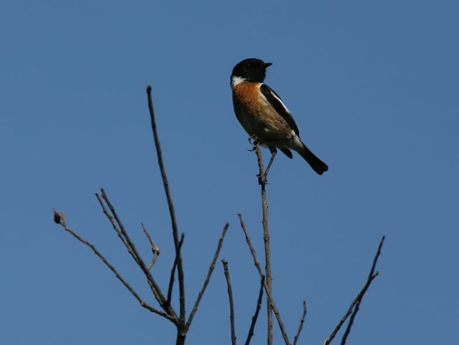

Once common in traditionally managed, low intensity grasslands, the Stonechat has declined in many areas of Switzerland following the intensification of agricultural practices. However, the species readily colonize set-aside and wildflower areas promoted by the Swiss agri-environment scheme. We compared the foraging and reproductive ecology of two Stonechat populations: one in Geneva (revitalized matrix with wildflower set-asides) and one in Upper Valais (traditional, extensive grassland). The density and reproductive performance did not differ strikingly between the two areas, suggesting that these agri-environment schemes provide suitable alternative conditions for insectivorous birds foraging on sward-dwelling invertebrates in modern farmland.

## Uni Bern supervisor

Raphaël Arlettaz

## Publications

Revaz, E., M. Schaub & R. Arlettaz. 2008. Foraging ecology and reproductive biology of the Stonechat *Saxicola torquata*: comparison between a revitalized, intensively cultivated and a historical, traditionally cultivated agro-ecosystem. Journal of Ornithology 149: 301-312. [(PDF, 443KB)](/files/stonechat/Revaz_JOrn2008_eng.pdf)

## Related Diploma/Master thesis

Revaz, E. 2000. Ecologie trophique et reproduction chez le Tarier pâtre *Saxicola torquata*: comparaison entre paysages agricoles traditionnel et revitalisé. Diploma Thesis. University of Neuchâtel.
