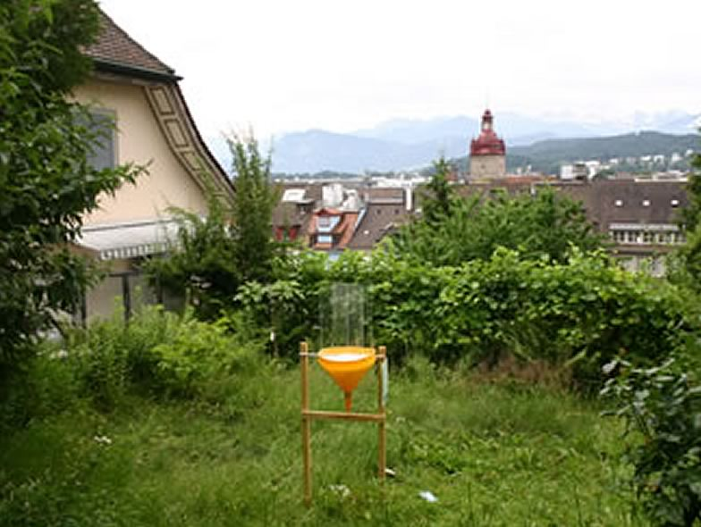

Nowadays, more than half of the World’s population is urban (in Switzerland app. 75%), with an increasing trend. Even though the novel urban ecosystem is often undervalued, it supports surprisingly high biodiversity and is essential for human well-being. Our project ‘BiodiverCity’ adopted a novel trans- and interdisciplinary research approach, with ecologists, social scientists, practitioners, and stakeholders working together, to assess urban biodiversity and attitudes of people in order to identify the needs of the residents and key factors that positively influence quality of life and biodiversity in the urban environment.
Invertebrates, birds, and bats were investigated in Zürich, Luzern, and Lugano, which were selected as being representative for small to medium sized European cities. Urban environmental variables measured at different spatial scales and space-only variables were used to identify urban matrix characteristics that most influence the number of species and community composition. The same urban characteristics were used in the interviews with the public at the national level and with urban residents. In this way, comprehensive conclusion are drawn, on how urban areas are to be planned and managed to support both, a diverse biodiversity and satisfied inhabitants.

## Uni Bern supervisors

Fabio Bontadina, Raphaël Arlettaz

## External collaborators

Prof. Dr. Peter Duelli, Dr. Martin Obrist, Swiss Federal Institute for Forest, Snow and Landscape Research WSL, Birmensdorf

Dr. Marco Moretti, Swiss Federal Institute for Forest, Snow and Landscape Research WSL, Bellinzona

Prof. Dr. Daniel Borcard , Prof. Dr. Pierre Legendre, Département de Sciences Biologiques, Université de Montréal, Montreal, Canada

## Further informations

[Link to project website](https://www.wsl.ch/de/landschaft/siedlung-und-raum/urbane-gruenraeume/biodivercity.html)

## Publications

Fontana, S., T. Sattler, F. Bontadina & M. Moretti. 2011. How to manage the urban green to improve bird diversity and community structure. Landscape and Urban Planning 101: 278-285. [(PDF, 457KB)](/files/urban_biodivercity/Fontana_LanUrbPla2011_eng.pdf)

Sattler, T., D. Borcard, R. Arlettaz, F. Bontadina, P. Legendre, M.K. Obrist & M. Moretti. 2010. Spider, bee, and bird communities in cities are shaped by environmental control and high stochasticity. Ecology 91: 3343-3353. [(PDF, 368KB)](/files/urban_biodivercity/Sattler_Eco2010_eng.pdf)

Sattler, T., P. Duelli, M.K. Obrist, R. Arlettaz & M. Moretti. 2010. Response of arthropod species richness and functional groups to urban habitat structure and management. Landscape Ecology 25: 941-954. [(PDF, 352KB)](/files/urban_biodivercity/Sattler_LanEco2010_eng.pdf)

Germann, C., T. Sattler, M.K. Obrist & M. Moretti. 2008. Xero-thermophilous and grassland ubiquist species dominate the weevil fauna of Swiss cities (Coleoptera, Curculionoidea). Mitteilungen der Schweizerischen Entomologischen Gesellschaft/Bulletin de la Société Entomologique Suisse 81: 141-154. [(PDF, 648KB)](/files/urban_biodivercity/Germann_MitSchEntGes2008_eng.pdf)

Kouakou, D., T. Sattler, M.K. Obrist, P. Duelli & M. Moretti. 2008. Recent Swiss records of rare bee species (Hymenoptera, Apidae) with two species new to Switzerland. Mitteilungen der Schweizerischen Entomologischen Gesellschaft/Bulletin de la Société Entomologique Suisse 81: 191-197. [(PDF, 275KB)](/files/urban_biodivercity/Kouakou_MitSchEntGes2008_eng.pdf)

## Related PhD Thesis

Sattler, T. 2009. Biodiversity in urban landscape matrices: from species richness to functional community structure. PhD Thesis, University of Bern. [(PDF, 3.3 MB)](/files/urban_biodivercity/Sattler_PhD2009_eng.pdf)
