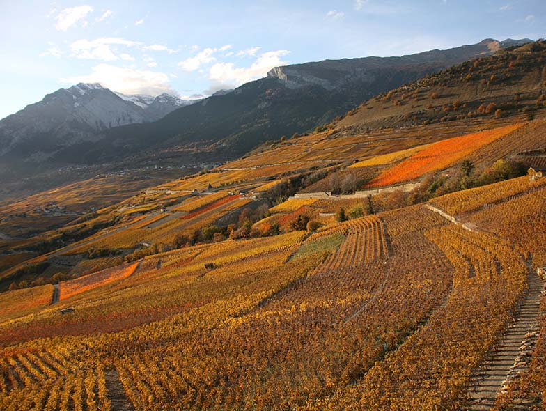

Vineyards belong to those agricultural crops that underwent rapid intensification after World War II, reflected in an ample reliance upon pesticides. However, there has been a recent trend towards more nature-friendly practices. As a result, insecticides were banned from Swiss vineyards, progressively replaced by biological control agents. An important aspect of vineyard management, with strong implications for biodiversity, is the management of the ground vegetation cover, which varies a lot between viticultural estates. Still largely combatted with herbicides in intensively cultivated vineyards, vegetation cover is mechanically limited in vineyards applying the organic and biodynamic cultivation protocols. This leads to vineyard areas characterised by a variegated landscape matrix in which ground-vegetated and bare-soil vineyards coexist spatially. In Valais (SW Switzerland), for instance, herbicides are still applied at large scales (70–80% of overall vineyard area), meaning that the fraction of ground-vegetated vineyards remains small. As a result, ground-vegetated vineyards offering good conditions for biodiversity occur in the form of islands in the landscape, since other forms of grape cultivation still predominate, which limits the distribution and dispersal ability of organisms. As vineyards may offer conditions for habitat specialists that typically characterise southern biomes, efforts must continue to render them more biodiversity friendly. A major focus of our studies on vineyard biodiversity has been on an emblematic passerine of dry habitat, the woodlark, and the arthropod community providing its staple food. More recent research has focused on management questions revolving around the spatial availability of habitat of high quality and connectivity, providing recommendations to enhance the dispersal of propagules, i.e. efficient ecological networks. Different management regimes were also compared from the viewpoint of their impact on biodiversity

### Uni Bern supervisors

Alain Jacot & Raphaël Arlettaz

### Publications

Bosco, L., V. Moser, M.M. Jones, Ø. Opedal, O. Ovaskainen, S. Gerber, R. Van Klink, S.A. Cushman, R. Arlettaz & A. Jacot. 2023. Habitat area and local habitat conditions outweigh fragmentation effects on insect communities in vineyards. Ecological Solutions and Evidence 4: e12193. [PDF](/files/vineyards/Bosco_EcoSolEvi2023_eng.pdf)

Bosco, L., D. Siegenthaler, L. Ruzzante, A. Jacot & R. Arlettaz. 2022. Varying Responses of Invertebrates to Biodynamic, Organic and Conventional Viticulture. Frontiers in Conservation Science 3: Article 837551. [PDF](/files/vineyards/Bosco_FroConSci2022_eng.pdf)

Bosco, L., S.A. Cushman, H.Y. Wan, K.A. Zeller, R. Arlettaz & A. Jacot. 2021. Fragmentation effects on woodlark habitat selection depend on habitat amount and spatial scale. Animal Conservation 24: 84-94. [(PDF, 1.7 MB)](/files/vineyards/Bosco_AniCon2021_eng.pdf)

Maurer, C., L. Bosco, E. Klaus, S.A. Cushman, R. Arlettaz & A. Jacot. 2020. Habitat amount mediates the effect of fragmentation on a pollinator’s reproductive performance, but not on its foraging behaviour. Oecologia 193: 523-534. [(PDF, 1007KB)](/files/vineyards/Maurer_Oec2020_eng.pdf)

Bosco, L., R. Arlettaz & A. Jacot. 2019. Ground greening in vineyards promotes the Woodlark *Lullula arborea* and their invertebrate prey. Journal of Ornithology 160: 799-811. [(PDF, 1.3 MB)](/files/vineyards/Bosco_JOrn2019_eng.pdf)

Bosco, L., H.Y. Wan, S.A. Cushman, R. Arlettaz & A. Jacot. 2019. Separating the effects of habitat amount and fragmentation on invertebrate abundance using a multi-scale framework. Landscape Ecology 34: 105-117. [(PDF, 1.0 MB)](/files/vineyards/Bosco_LanEco2019_eng.pdf)

Buehler, R., L. Bosco, R. Arlettaz & A. Jacot. 2017. Nest site preferences of the Woodlark (*Lullula arborea*) and its association with artificial nest predation. Acta Oecologica 78: 41-46. [(PDF, 356KB)](/files/vineyards/Buehler_ActOec2017_eng.pdf)

Guyot, C., R. Arlettaz, P. Korner & A. Jacot. 2017. Temporal and Spatial Scales Matter: Circannual Habitat Selection by Bird Communities in Vineyards. PLoS ONE 12: e0170176. [(PDF, 2.2 MB)](/files/vineyards/Guyot_PLoSONE2017_eng.pdf)

Vickery, J. & R. Arlettaz. 2012. The importance of habitat heterogeneity at multiple scales for birds in European agricultural landscapes. In: Birds and Habitat: Relationships in Changing Landscapes (ed. R.J. Fuller), pp. 177-204. Cambridge University Press, Cambridge. [(PDF, 3.3 MB)](/files/vineyards/VickeryArlettaz_in_Fuller2012_eng.pdf)

Arlettaz, R., M.L. Maurer, P. Mosimann-Kampe, S. Nusslé, F. Abadi, V. Braunisch & M. Schaub. 2012. New vineyard cultivation practices create patchy ground vegetation, favouring Woodlarks. Journal of Ornithology 153: 229-238. [(PDF, 310KB)](/files/vineyards/Arlettaz_JOrn2012_eng.pdf)

Schaub, M., N. Martinez, A. Tagmann-Ioset, N. Weisshaupt, M.L. Maurer, T.S. Reichlin, F. Abadi, N. Zbinden, L. Jenni & R. Arlettaz. 2010. Patches of Bare Ground as a Staple Commodity for Declining Ground-Foraging Insectivorous Farmland Birds. PLoS ONE 5: e13115. [(PDF, 755KB)](/files/vineyards/Schaub_PLoSONE2010_eng.pdf)

Schaub, M., N. Zbinden, N. Martinez, M. Maurer, A. Ioset, R. Spaar, N. Weisshaupt & R. Arlettaz. 2008. Vögel brauchen lückige Vegetation zur Nahrungssuche — Végétation clairsemée, un habitat important pour la faune. Faktenblatt: Landwirtschaft — Fiche info: Agriculture, Schweizerische Vogelwarte/Station ornithologique suisse, Sempach. (Deutsch: [(PDF, 375KB)](/files/vineyards/Schaub_Gui2008d_eng.pdf)) (Französisch: [(PDF, 376KB)](/files/vineyards/Schaub_Gui2008f_eng.pdf))

Sierro, A. & R. Arlettaz. 2003. L'avifaune du vignoble en Valais central: évaluation de la diversité à l'aide de transects. Nos Oiseaux 50: 89-100. [(PDF, 4.3 MB)](/files/vineyards/Sierro_NosOis2003_eng.pdf)

### Related PhD thesis

**Bosco, L.** 2018. Effects of vineyard management and fragmentation on Woodlarks (*Lullula arborea*) and their invertebrate prey. PhD Thesis. University of Bern, Bern.

### Related Master theses

Poloni, S. 2025. Contribution of grape-protection nets in vineyards to avian mortality. MSc Thesis. University of Bern.

Höhener, L.S. 2025. Benefits and potential risks of perennial wildflower strips in vineyards for wild bees. MSc Thesis. University of Bern.

Klaus, E. 2018. Effects of habitat amount and fragmentation on reproductive success of insect-pollinated plants in a Swiss vineyard landscape. MSc Thesis. University of Bern. [PDF](/files/vineyards/Klaus_MSc2018_eng.pdf)

Maurer, C. 2018. Effects of habitat amount and fragmentation in vineyards on bumblebee colony fitness and foraging behaviour. MSc Thesis. University of Bern. [PDF](/files/vineyards/Maurer_MSc2018_eng.pdf)

Mazenauer, J. 2018. Semi-natural habitat versus ground vegetation in vineyards : disentangling birds’ habitat preferences at a landscape scale. MSc Thesis. University of Bern. [PDF](/files/vineyards/Mazenauer_MSc2018_eng.pdf)

Siegenthaler, D. 2017. Conventional, organic and biodynamic: the response of arthropod communities to vineyard management regime. MSc Thesis. University of Bern. [PDF](/files/vineyards/Siegenthaler_MSc2017_eng.pdf)

Ruzzante, L. 2016/2017. The effects of management regime on arthropod communities in Argentinian vineyards. MSc Thesis. University of Bern. [PDF](/files/vineyards/Ruzzante_MSc2016_2017_eng.pdf)

Guyot, C. 2016. Temporal and spatial scales matter: circannual habitat selection of bird communities in vineyards. MSc Thesis. Universität Bern. [PDF](/files/vineyards/Guyot_MSc2016_eng.pdf)

Bosco, L. 2014. The effects of ground vegetation cover on vineyard habitat use by the woodlark *Lullula arborea* and its arthropod prey. MSc Thesis, University of Bern. [PDF](/files/vineyards/Bosco_MSc2014_eng.pdf)

Maurer, M.L. 2006. Emergence of new cultivation practices in vineyards: Any benefit for the endangered Woodlark *Lullula arborea*? Diploma Thesis, University of Bern. [PDF](/files/vineyards/Maurer_Dipl2006copy_eng.pdf)
