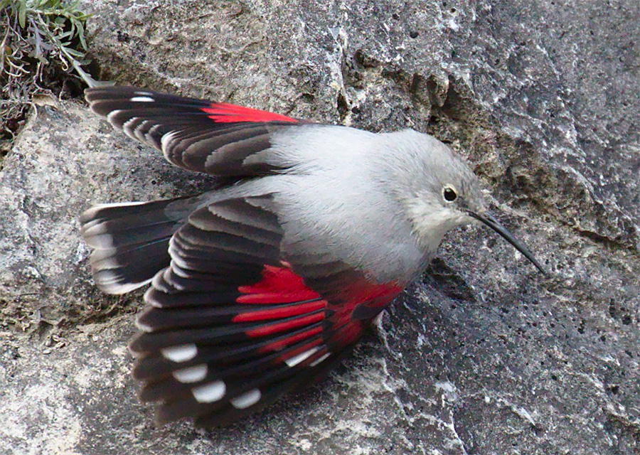

The Wallcreeper (*Tichodroma muraria*) is a beautiful Eurasian songbird whose exclusive use of cliffs and large rock faces make it emblematic of high elevation montane ecosystems. Due to the extreme inaccessibility of its habitats, the Wallcreeper remains a poorly studied and understood bird, and basic knowledge on its ecology and abundance is still lacking. Breeding mainly in the alpine zone during the summer before migrating to lower altitudes for the winter, the species is likely thermally constrained throughout its life cycle, and global warming is expected to have a marked impact on its life history. Using the species as a model for other alpine birds, we are exploring the potential impacts of warming temperatures at two scales. First, we are using state-of-the-art species distribution modelling approaches to predict changes in its winter and breeding distributions across Switzerland under various climate scenarios. This project will also lay the groundwork for developing a species-specific population monitoring program and improving population size estimates. Second, we are using fine scale foraging observations to examine how microhabitat and microclimate variation within rock faces regulate the species’ behavior.

## Uni Bern supervisors

Raphaël Arlettaz, Ian Ausprey, Sergio Vignali, Veronika Braunisch

## Publications

Luisier, C., S. Vignali, V. Braunisch, A.G. Barras, M. Kéry, R. Arlettaz & I.J. Ausprey. 2026. Climate Change Predicted to Trigger an Upward Altitudinal Range Shift and Boost the Abundance of a Montane Rock Face Specialist, the Wallcreeper (*Tichodroma muraria*). Ecology and Evolution 16: e73963. [PDF](/files/publications/Luisier_EcoEvo2026_eng.pdf)

## Related Master Thesis

Luisier, C. 2023. Year round effects of climate change on the distribution and abundance of a rock face specialized montane bird, the Wallcreeper (*Tichodroma muraria*). Master Thesis, University of Bern. [PDF](/files/wallcreeper/Luisier_MSc2023_eng.pdf)
