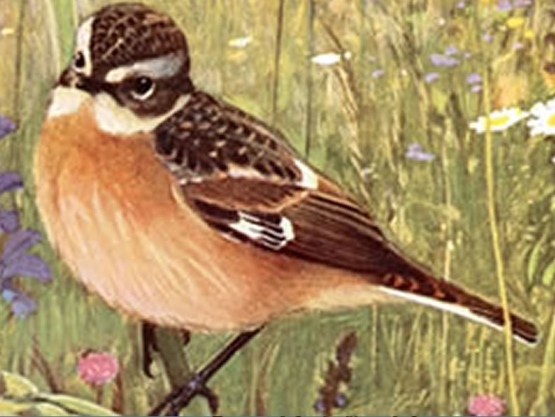

The Whinchat is a typical inhabitant of low-intensity meadowland. Once widespread across Central Europe, it has now vanished from most lowland farmland. Even populations occurring in subalpine meadows are now declining rapidly. We investigated the effects of farming practices intensification in Lower Engadin, comparing diet, food availability and reproductive output of pairs breeding in high-intensity (fertilization with liquid manure and slurry, aerial irrigation with sprinklers, 2+ cuts a year) vs pairs breeding in low intensity meadows (low fertilization and only with solid manure; no sprinklers; 1-2 cuts a year). Food availability was much reduced in intensive meadows, which led to a less abundant and diverse diet provisioned to chicks. Reproductive success was also lower in intensive meadows, despite the fact that we could remove the traditional destructive effect of too early mowings (by maitaining an uncut grass refuge around the nest), which typically mechanically destroy the nests in high hay output grasslands. Only extensification of grassland management can enable the species to survive in farmland.

## Uni Bern supervisor

Alain Jacot, Raphaël Arlettaz

## Publications

Strebel, G., A. Jacot, P. Horch & R. Spaar. 2015. Effects of grassland intensification on Whinchats *Saxicola rubetra* and implications for conservation in upland habitats. Ibis 157:250-259. [(PDF, 231KB)](/files/whinchat/Strebel_Ibis2015_eng.pdf)

Britschgi, A., R. Spaar & R. Arlettaz. 2006. Impact of grassland farming intensification on the breeding ecology of an indicator insectivorous passerine, the Whinchat *Saxicola rubetra*: Lessons for overall Alpine meadowland management. Biological Conservation 130: 193-205. [(PDF, 285KB)](/files/whinchat/Britschgi_BioCon2006_eng.pdf)

## Related Diploma/Master thesis

Britschgi, A. 2003. Comparative feeding ecology of the Whinchat *Saxicola rubetra* on intensively and extensively managed grassland. Diploma Thesis, University of Bern. [PDF](/files/whinchat/Britschgi_Dipl2003copy_eng.pdf)
