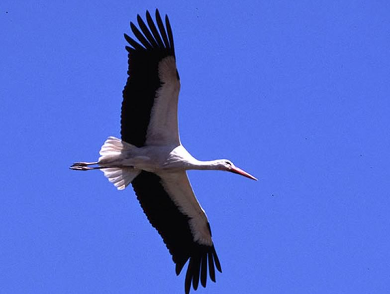

The white stork went extinct in Switzerland in 1950 - shortly thereafter Max Blösch started a reintroduction project. This project was successful and the population increased to about 200 breeding pairs. In a series of works we evaluated the chances that the white stork population can survive in Switzerland also in future, we estimated the proportion of storks that died at electric power lines and tested whether this human-induced cause of mortality is additive or compensatory to the natural mortality. Using data of white storks from Poland and eastern Germany, we finally modeled the annual survival probabilities in relation to environmental correlates in the wintering areas. This study showed that primary production at migratory stopover sites can have an impact on annual survival, and thus on population dynamics.

## Uni Bern supervisor

Michael Schaub

## Publications

Arizaga, J., J. Resano-Mayor, D. Villanúa, D. Alonso, J.M. Barbarin, A. Herrero, J.M. Lekuona & R. Rodríguez. 2018. Importance of artificial stopover sites through avian migration flyways: a landfill-based assessment with the White Stork *Ciconia ciconia*. Ibis 160: 542-553.  [(PDF, 554KB)](/files/white_stork/Arizaga_Ibis2018_eng.pdf)

Schaub, M., W. Kania & U. Köppen. 2005. Variation of primary production during winter induces synchrony in survival rates in migratory white storks *Ciconia ciconia*. Journal of Animal Ecology 74: 656-666. [(PDF, 237KB)](/files/white_stork/Schaub_JAniEco2005_eng.pdf)

Schaub, M., R. Pradel & J.D. Lebreton. 2004. Is the reintroduced white stork (*Ciconia ciconia*) population in Switzerland self-sustainable? Biological Conservation 119: 105-114. [(PDF, 275KB)](/files/white_stork/Schaub_BioCon2004_eng.pdf)

Schaub, M. & R. Pradel. 2004. Assessing the relative importance of different sources of mortality from recoveries of marked animals. Ecology 85: 930-938. [Schaub_Eco2004a.pdf (PDF, 92KB)](/files/electricity_networks/Schaub_Eco2004a_eng.pdf)

Schaub, M. & J.D. Lebreton. 2004. Testing the additive versus the compensatory hypothesis of mortality from ring recovery data using a random effects model. Animal Biodiversity and Conservation 27: 73-85. [(PDF, 857KB)](/files/electricity_networks/Schaub_AniBiodivCon2004_eng.pdf)

Berthold, P., A. Aebischer, M. Kaatz & U. Querner. 2002. Erstnachweis der Wanderungen und Aufenthaltsgebiete eines Weissstorchs *Ciconia ciconia* vom Ausfliegen bis zum ersten Brüten mit Hilfe der Satelliten-Telemetrie. Der Ornithologische Beobachter 99: 227-229. [(PDF, 214KB)](/files/white_stork/Berthold_OrnBeo2002_eng.pdf)
