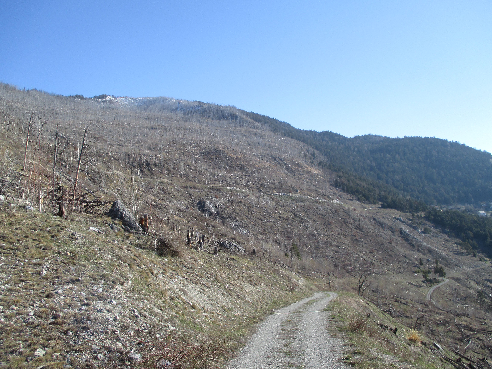

Wildfires and windstorms are dynamic processes that can heavily impact habitats and alter their species compositions. Especially species of open and semi-open habitats can benefit from such disturbances, among them several bird species. In this project, we investigated the short- and mid-term changes of the breeding bird community in the burnt forest of Leuk and Visp. Looking at species-specific reactions helps understanding the on-going underlying ecological processes and highlights the importance of forest fires for avian biodiversity

## Uni Bern supervisors

Alain Jacot, Raphaël Arlettaz

## External collaboration

Swiss Ornithological Institute, Valais Field Station

## Publications

Rey, L., M. Kéry, A. Sierro, B. Posse, R. Arlettaz & A. Jacot. 2019. Effects of forest wildfire on inner-Alpine bird community dynamics. PLoS ONE 14: e0214644. [(PDF, 1.1 MB)](/files/wildfires_and_avian_communities/Rey_PLoSONE2019_eng.pdf)

Rey, L. & A. Jacot. 2018. Die Entwicklung der Brutvögel in der Waldbrandfläche bei Leuk. Schweizerische Zeitschrift für Forstwesen 169: 299-307. [PDF](/files/wildfires_and_avian_communities/Rey_SchZFor2018_eng.pdf)

## Related Master thesis

Rey, L. 2015. The effects of forest wildfire on bird communities in an inner-alpine valley: fire as a future management tool for rare avifauna? Master Thesis, University of Bern. [PDF](/files/wildfires_and_avian_communities/Rey_MSc2015_eng.pdf)
