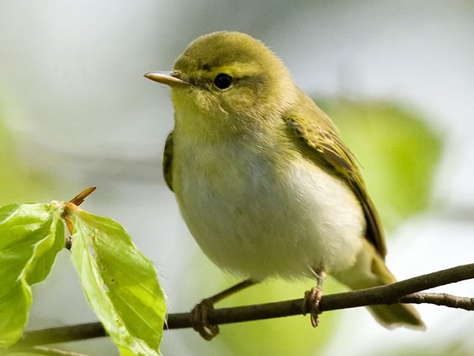

The Wood Warbler *P**hylloscopus sibilatrix* is a typical long-distance migrant. Throughout Western Europe Wood Warbler populations have declined in the last 3 decades, while in eastern Europe populations are subject to great fluctuations. For the Wood Warbler it remains unclear what factors influence breeding success. While there may be carrying over effects arising from conditions in their wintering areas or during migration, it has largely been shown that structural habitat changes due to changing forestry practices is the greatest threat to this species. Besides habitat loss also predation has been shown to have a substantial impact on nest success, with 80% to 95% of all nest losses caused by predation. A current MSc study attempts to further shed light on factors influencing habitat choice and nest success.

## Uni Bern supervisor

Raphaël Arlettaz

## External collaborator

Dr. Gilberto Pasinelli, Swiss Ornithological Institute Sempach

## Publications

Maag, N., M.D. Burgess, M. Maziarz, S. Lüpold, J.W. Mallord, R.K. Broughton, A. Cristinacce, R. Arlettaz, S. Carlotti, J. Castello, T. Davis, M. Gerber, A. Grendelmeier, C.J. Orsman, M. Riess, P. Stelbrink, T. Wesołowski, Z. Züst & G. Pasinelli. 2022. Reproductive success of the wood warbler *Phylloscopus sibilatrix* varies across Europe. Journal of Avian Biology 2022: e03033. [PDF](/files/wood_warbler/Maag_JAviBio2022_eng.pdf)

Maag, N., J.W. Mallord, M.D. Burgess, S. Lüpold, A. Cristinacce, R. Arlettaz, S. Carlotti, T.M. Davis, A. Grendelmeier, C.J. Orsman, M. Riess, P. Stelbrink & G. Pasinelli. 2022. Accounting for predator species identity reveals variable relationships between nest predation rate and habitat in a temperate forest songbird. Ecology and Evolution 12: e9411. [PDF](/files/wood_warbler/Maag_EcoEvo2022_eng.pdf)

Maziarz, M., A. Grendelmeier, T. Wesołowski, R. Arlettaz, R.K. Broughton & G. Pasinelli. 2019. Patterns of predator behaviour and Wood Warbler *Phylloscopus sibilatrix* nest survival in a primaeval forest. Ibis 161:854-866. [(PDF, 290KB)](/files/wood_warbler/Maziarz_Ibis2019_eng.pdf)

Stelbrink, P., A. Grendelmeier, D. Schabo, R. Arlettaz, F. Hillig & G. Pasinelli. 2019. Does acoustically simulated predation risk affect settlement and reproduction of a migratory passerine? Ethology 125: 535-547. [(PDF, 514KB)](/files/wood_warbler/Stelbrink_Eth2019_eng.pdf)

Grendelmeier, A., R. Arlettaz & G. Pasinelli. 2018. Numerical response of mammalian carnivores to rodents affects bird reproduction in temperate forests: A case of apparent competition? Ecology and Evolution 8: 11596-11608. [(PDF, 882KB)](/files/wood_warbler/Grendelmeier_EcoEvo2018_eng.pdf)

Grendelmeier, A., R. Arlettaz, J. Olano-Marin & G. Pasinelli. 2017. Experimentally provided conspecific cues boost bird territory density but not breeding performance. Behavioral Ecology 28: 174-185. [(PDF, 822KB)](/files/wood_warbler/Grendelmeier_BehEco2017_eng.pdf)

Grendelmeier, A., R. Arlettaz, M. Gerber & G. Pasinelli. 2015. Reproductive Performance of a Declining Forest Passerine in Relation to Environmental and Social Factors: Implications for Species Conservation. PLoS ONE 10: e0130954. [(PDF, 628KB)](/files/wood_warbler/Grendelmeier_PLoSONE2015_eng.pdf)

Pasinelli, G. 2011. Choix de territoire, succès de reproduction et prédation chez le pouillot siffleur. Avinews, mars 2011. [(PDF, 1.2 MB)](/files/wood_warbler/Pasinelli_Avinews2011_eng.pdf)

## Related PhD thesis

Grendelmeier, A. 2016. Coping with unpredictable environments: mechanisms underlying settlement and predatio in a long-distance migratory forest passerine. PhD Thesis, University of Bern. [PDF](/files/wood_warbler/Grendelmeier_PhD2016copy_eng.pdf)

## Related Diploma/Master thesis

Grendelmeier, A. 2011. The enigmatic decline of the Wood Warbler *Phylloscopus sibilatrix*: nest predation and habitat characteristics. Master Thesis, University of Bern. [(PDF, 1.1 MB)](/files/wood_warbler/Grendelmeier_MSc2011_eng.pdf)
