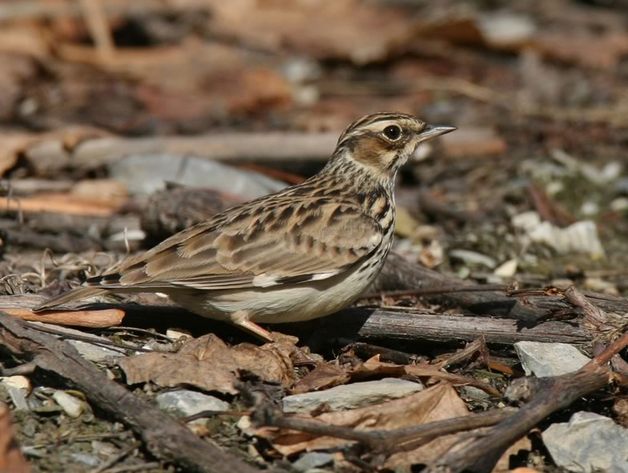

New management practices are currently spreading in European vineyards. We investigated habitat selection in Valais to test whether vegetated vineyards (grass layer on the soil) provide more suitable and more attractive habitat conditions for the species than conventional, mineral vineyards systematically treated with herbicides. The species typically prefers heterogeneous foraging sites offering a fine-grained mosaic where patches of short grass vegetation alternate with patches of bare ground.

## Uni Bern supervisor

Raphaël Arlettaz

## External collaborator

Paul Mosimann-Kampe, independent ecological consultant, Ins, Switzerland

## Publications

Bosco, L., S.A. Cushman, H.Y. Wan, K.A. Zeller, R. Arlettaz & A. Jacot. 2021. Fragmentation effects on woodlark habitat selection depend on habitat amount and spatial scale. Animal Conservation 24: 84-94. [(PDF, 1.7 MB)](/files/vineyards/Bosco_AniCon2021_eng.pdf)

Bosco, L., R. Arlettaz & A. Jacot. 2019. Ground greening in vineyards promotes the Woodlark *Lullula arborea* and their invertebrate prey. Journal of Ornithology 160: 799-811. [(PDF, 1.3 MB)](/files/vineyards/Bosco_JOrn2019_eng.pdf)

Bosco, L., H.Y. Wan, S.A. Cushman, R. Arlettaz & A. Jacot. 2019. Separating the effects of habitat amount and fragmentation on invertebrate abundance using a multi-scale framework. Landscape Ecology 34: 105-117. [(PDF, 1.0 MB)](/files/vineyards/Bosco_LanEco2019_eng.pdf)

Buehler, R., L. Bosco, R. Arlettaz, and A. Jacot. 2017. Nest site preferences of the Woodlark (*Lullula arborea*) and its association with artificial nest predation. Acta Oecologica 78: 41-46. [(PDF, 356KB)](/files/vineyards/Buehler_ActOec2017_eng.pdf)

Vickery, J. & R. Arlettaz. 2012. The importance of habitat heterogeneity at multiple scales for birds in European agricultural landscapes. In: Birds and Habitat: Relationships in Changing Landscapes (ed. R.J. Fuller), pp. 177-204. Cambridge University Press, Cambridge. [(PDF, 3.3 MB)](/files/vineyards/VickeryArlettaz_in_Fuller2012_eng.pdf)

Arlettaz, R., M.L. Maurer, P. Mosimann-Kampe, S. Nusslé, F. Abadi, V. Braunisch & M. Schaub. 2012. New vineyard cultivation practices create patchy ground vegetation, favouring Woodlarks. Journal of Ornithology 153: 229-238. [(PDF, 310KB)](/files/vineyards/Arlettaz_JOrn2012_eng.pdf)

Schaub, M., N. Martinez, A. Tagmann-Ioset, N. Weisshaupt, M.L. Maurer, T.S. Reichlin, F. Abadi, N. Zbinden, L. Jenni & R. Arlettaz. 2010. Patches of Bare Ground as a Staple Commodity for Declining Ground-Foraging Insectivorous Farmland Birds. PLoS ONE 5: e13115. [(PDF, 755KB)](/files/vineyards/Schaub_PLoSONE2010_eng.pdf)

Schaub, M., N. Zbinden, N. Martinez, M. Maurer, A. Ioset, R. Spaar, N. Weisshaupt & R. Arlettaz. 2008. Vögel brauchen lückige Vegetation zur Nahrungssuche — Végétation clairsemée, un habitat important pour la faune. Faktenblatt: Landwirtschaft — Fiche info: Agriculture, Schweizerische Vogelwarte/Station ornithologique suisse, Sempach. (Deutsch: [(PDF, 375KB)](/files/vineyards/Schaub_Gui2008d_eng.pdf)) (Französisch: [(PDF, 376KB)](/files/vineyards/Schaub_Gui2008f_eng.pdf))

## Related PhD Thesis

Bosco, L. 2018. Effects of vineyard management and fragmentation on Woodlarks (*Lullula arborea*) and their invertebrate prey. PhD Thesis, University of Bern.

## Related Diploma/Master theses

Bosco, L. 2014. The effects of ground vegetation cover on vineyard habitat use by the woodlark *Lullula arborea* and its arthropod prey. Master Thesis, University of Bern. [(PDF, 654KB)](/files/vineyards/Bosco_MSc2014_eng.pdf)

Maurer, M.L. 2006. Emergence of new cultivation practices in vineyards: Any benefit for the endangered Woodlark *Lullula arborea*? Diploma Thesis, University of Bern. [PDF](/files/vineyards/Maurer_Dipl2006copy_eng.pdf)
