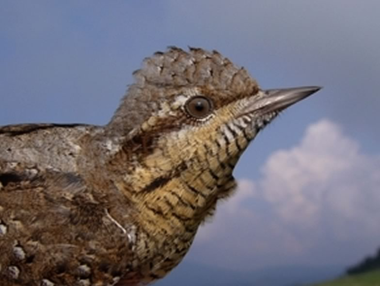

Wryneck (*Jynx torquilla*) populations are declining in whole Europe. The reasons for this decline are not fully understood and it is therefore difficult to propose sound conservation actions. We study the dynamics of a population in the Valais as well as the habitat selection in different areas.

## Uni Bern supervisors

Michael Schaub, Raphaël Arlettaz

## Publications

Tenan, S., D. Becker, D. Tolkmitt & M. Schaub. 2021. Decomposing fecundity and evaluating demographic influence of multiple broods in a migratory bird. Journal of Animal Ecology 90: 1071-1084.  [(PDF, 1.1 MB)](/files/wryneck/Tenan_JAniEco2021_eng.pdf)

Vickery, J. & R. Arlettaz. 2012. The importance of habitat heterogeneity at multiple scales for birds in European agricultural landscapes. In: Birds and Habitat: Relationships in Changing Landscapes (ed. R.J. Fuller), pp. 177-204. Cambridge University Press, Cambridge. [(PDF, 3.3 MB)](/files/vineyards/VickeryArlettaz_in_Fuller2012_eng.pdf)

Schaub, M., T.S. Reichlin, F. Abadi, M. Kéry, L. Jenni & R. Arlettaz. 2012. The demographic drivers of local population dynamics in two rare migratory birds. Oecologia 168: 97-108. [(PDF, 413KB)](/files/hoopoe/Schaub_Oec2012_eng.pdf)

Weisshaupt, N., R. Arlettaz, T.S. Reichlin, A. Tagmann-Ioset & M. Schaub. 2011. Habitat selection by foraging Wrynecks *Jynx torquilla* during the breeding season: identifying the optimal habitat profile. Bird Study 58: 111-119. [(PDF, 212KB)](/files/wryneck/Weisshaupt_BirStu2011_eng.pdf)

Coudrain, V., R. Arlettaz & M. Schaub. 2010. Food or nesting place? Identifying factors limiting Wryneck populations. Journal of Ornithology 151: 867-880. [(PDF, 533KB)](/files/wryneck/Coudrain_JOrn2010_eng.pdf)

Reichlin, T.S., K.A. Hobson, L.I. Wassenaar, M. Schaub, D. Tolkmitt, D. Becker, L. Jenni & R. Arlettaz. 2010. Migratory connectivity in a declining bird species: using feather isotopes to inform demographic modelling. Diversity and Distributions 16: 643-654. [(PDF, 1.1 MB)](/files/wryneck/Reichlin_DivDtr2010_eng.pdf)

Schaub, M., N. Martinez, A. Tagmann-Ioset, N. Weisshaupt, M.L. Maurer, T.S. Reichlin, F. Abadi, N. Zbinden, L. Jenni & R. Arlettaz. 2010. Patches of Bare Ground as a Staple Commodity for Declining Ground-Foraging Insectivorous Farmland Birds. PLoS ONE 5:e13115. [(PDF, 755KB)](/files/vineyards/Schaub_PLoSONE2010_eng.pdf)

Zingg, S., R. Arlettaz & M. Schaub. 2010. Nestbox design influences territory occupancy and reproduction in a declining, secondary cavity-breeding bird. Ardea 98: 67-75. [(PDF, 359KB)](/files/wryneck/Zingg_Ardea2010_eng.pdf)

Mermod, M., T.S. Reichlin, R. Arlettaz & M. Schaub. 2009. Vorläufige Ergebnisse einer Langzeitstudie zum Wendehals in der Schweiz. In: Jahrestagung 2008 der Projektgruppe Spechte der Deutschen Ornithologen-Gesellschaft - Aktuelle Beiträge zur Spechtforschung (eds T. Späth & A. Kirzinger), pp. 78-81. Nationalparkverwaltung Harz, Wernigerode. [(PDF, 2.0 MB)](/files/wryneck/Mermod_BS2009_eng.pdf)

Mermod, M., T.S. Reichlin, R. Arlettaz & M. Schaub. 2009. The importance of ant-rich habitats for the persistence of the Wryneck *Jynx torquilla* on farmland. Ibis 151: 731-742. [(PDF, 433KB)](/files/wryneck/Mermod_Ibis2009_eng.pdf)

Reichlin, T.S., M. Schaub, R. Arlettaz & L. Jenni. 2009. Zugrichtungen europäischer Wendehälse. In: Jahrestagung 2008 der Projektgruppe Spechte der Deutschen Ornithologen-Gesellschaft - Aktuelle Beiträge zur Spechtforschung (eds T. Späth & A. Kirzinger), pp. 82-85. Nationalparkverwaltung Harz, Wernigerode. [(PDF, 503KB)](/files/wryneck/Reichlin_BS2009_eng.pdf)

Reichlin, T.S., M. Schaub, M.H.M. Menz, M. Mermod, P. Portner, R. Arlettaz & L. Jenni. 2009. Migration patterns of Hoopoe *Upupa epops* and Wryneck *Jynx torquilla* : an analysis of European ring recoveries. Journal of Ornithology 150: 393-400. [(PDF, 1.4 MB)](/files/hoopoe/Reichlin_JOrn2009_eng.pdf)

Tolkmitt, D., D. Becker, T.S. Reichlin & M. Schaub. 2009. Variation der Gelegegrößen des Wendehalses *Jynx torquilla* in Untersuchungsgebieten Deutschlands und der Schweiz. In: Jahrestagung 2008 der Projektgruppe Spechte der Deutschen Ornithologen-Gesellschaft - Aktuelle Beiträge zur Spechtforschung (eds T. Späth & A. Kirzinger), pp. 69-77. Nationalparkverwaltung Harz, Wernigerode. [(PDF, 2.5 MB)](/files/wryneck/Tolkmitt_BS2009_eng.pdf)

Weisshaupt, N. 2009. L'habitat di foraggiamento del Torcicollo *Jynx torquilla*. Ficedula 42: 18-23. [(PDF, 2.7 MB)](/files/wryneck/Weisshaupt_Fice2009_eng.pdf)

Geiser, S., R. Arlettaz & M. Schaub. 2008. Impact of weather variation on feeding behaviour, nestling growth and brood survival in Wrynecks *Jynx torquilla*. Journal of Ornithology 149: 597-606. [(PDF, 242KB)](/files/wryneck/Geiser_JOrn2008_eng.pdf)

Mermod, M., T.S. Reichlin, R. Arlettaz & M. Schaub. 2008. Wiedehopfpaar zieht Wendehalsnestlinge bis zum Ausfliegen auf. Der Ornithologische Beobachter 105: 153-160. [(PDF, 1.3 MB)](/files/wryneck/Mermod_OrnBeo2008_eng.pdf)

## Related PhD Thesis

Abadi Gebreselassie, F. 2010. Regulation of local bird populations: Deeper insights from integrated population models. PhD Thesis, University of Bern. [PDF](/files/hoopoe/AbadiGebreselassie_PhD2010copy_eng.pdf)

Reichlin, T.S. 2009. Population dynamics of two endangered bird species, *Upupa epops* and *Jynx torquilla*, in Valais (Switzerland). PhD Thesis, University of Bern. [(PDF, 4.8 MB)](/files/hoopoe/Reichlin_PhD2009_eng.pdf)

## Related Diploma/Master theses

Coudrain, V. 2009. Food or nesting place? Identifying factors limiting wryneck populations. Master Thesis, University of Bern. [(PDF, 479KB)](/files/wryneck/Coudrain_MSc2009_eng.pdf)

Zingg, S. 2009. Nestbox design influences territory occupancy and reproduction in a declining, secondary cavity-breeding bird. Master Thesis, University of Bern. [(PDF, 1.6 MB)](/files/wryneck/Zingg_MSc2009_eng.pdf)

Mermod, M. 2008. Key ecological features for the persistence of an endangered migratory woodpecker of farmland, the wryneck *(Jynx torquilla*). Diploma Thesis, University of Bern. [(PDF, 764KB)](/files/wryneck/Mermod_Dipl2008_eng.pdf)

Weisshaupt, N. 2007. Habitat selection by foraging wrynecks *Jynx torquilla* during the breeding season: identifying optimal species habitat. Diploma Thesis, University of Bern. [PDF](/files/wryneck/Weisshaupt_Dipl2007copy_eng.pdf)

Geiser, S. 2005. Impact of weather conditions on food availability, feeding behaviour, nestling growth and brood survival in a Wryneck population in Valais (Switzerland). Diploma Thesis, University of Bern. [PDF](/files/wryneck/Geiser_Dipl2005copy_eng.pdf)

Ehrenbold, S. 2004. Habitat suitability modelling and components of reproductive success in the Wryneck *Jynx torquilla*. Diploma Thesis, University of Bern. [(PDF, 1.2 MB)](/files/wryneck/Ehrenbold_Dipl2004_eng.pdf)
