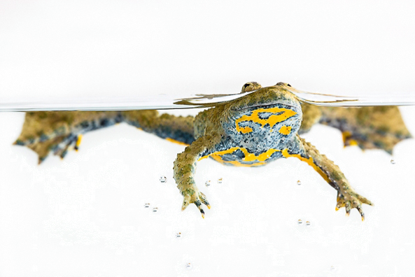

The yellow-bellied toad is an amphibian requesting highly-dynamic semi-aquatic habitat, mostly in flood plains. Systematic river damming from the XIXe century has destroyed its main habitat in many places, pushing populations to the break of extinction. However, recent river revitalisation programmes may enhance habitat quality and create opportunities for the reestablishment of the yellow-bellied toad in areas where it went extinct. However, in highly-fragmented habitats, where natural movements are hampered by human infrastructure for example, population restoration may need to be assisted with translocations. In this research programme we conduct tests of acclimatisation of this small amphibian to a new artificial site in Central Valais, along a revitalised stretch of the Rhone river, where the species is today extinct. Our goal is not only to reintroduce the species locally, but also to provide evidence-based guidance about acclimatisation and supplementation/reintroduction of anuran populations more generally.

## Uni Bern supervisor

Raphaël Arlettaz

## Publication

Cotting, S., S. Ursenbacher, R. Arlettaz, J. Pellet, P. Marchesi & F. Zanini. 2018. Sauvegarde des populations de sonneurs à ventre jaune (*Bombina variegata*) du Valais: analyse génétique comparative de différentes populations. Bulletin de la Murithienne 136: 31-41. [(PDF, 1012KB)](/files/yellow_bellied_toad/Cotting_BlMur2018_eng.pdf)
